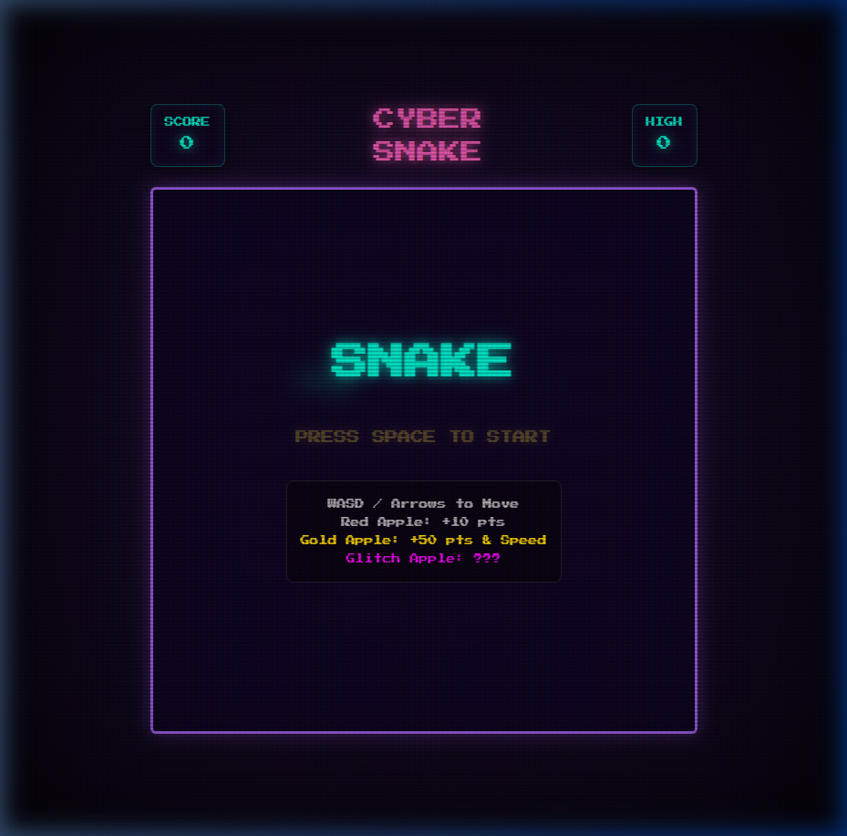

# 🐍 Cyber Snake 

A highly polished, Synthwave-themed "Retro Snake" game built entirely from scratch using **Vanilla Web Technologies** (HTML5 Canvas, CSS3, JavaScript ES6+). It features dynamic glassmorphism UI, complex custom Web Audio API synthesizers, multiple difficulties, and classic arcade progression. 

## ✨ Features

- **Synthwave Aesthetics:** Deep purples, neon pinks, and cyan color palettes with glowing gradients, floating UI panels (`backdrop-filter`), and animated CRT scanlines.
- **Dynamic Graphics:** Smooth 60fps canvas rendering with pulsing animations for the food and directional "glowing eyes" for the snake head.
- **Advanced Audio Engine:** Fully generated audio via Web Audio API. 
  - *No external MP3/WAV files used!* 
  - Features real-time generated White Noise explosions, coin-pickup arpeggios, layered synth pops, and victory fanfares.
- **Highscore System (Arcade Style):** Localstorage-based progression separated by difficulty levels. Includes a 3-letter Arcade Name Input UI using the D-Pad/Arrow Keys.
- **Multiple Game Modes:** Switch between EASY (150ms), NORMAL (100ms), and HARD (60ms) gameplay loops right from the Start Screen.
- **Juice & Polish:** "Glitch" and "Gold" special apples, inverse-control poison mechanics, and robust screen-shake animations upon death.

## 🚀 How to Run

Since the game uses zero dependencies and no framework build steps, you can technically just double-click the `index.html` file in your browser.

**Recommended Setup (Python HTTP Server):**
To ensure all modern browser policies for Web Audio API and local storage function seamlessly:
1. Open a terminal in the project directory.
2. Run `python -m http.server 8080` (or right-click `index.html` and "Open with Live Server" in VSCode).
3. Navigate to `http://localhost:8080/`

## 🎮 Controls

### Global / Game
- `W` `A` `S` `D` or **Arrow Keys**: Move the snake.
- `Spacebar`: Start the game / Restart.

### Menus
- **Start Screen:** `Left Arrow` / `Right Arrow` to switch difficulties.
- **Highscore Entry:** `Left` / `Right` to pick a letter slot. `Up` / `Down` to cycle through the alphabet. `Spacebar` to submit your highscore name.

---
*Created as a prototype evaluating Vanilla JS game engine architectures.*
